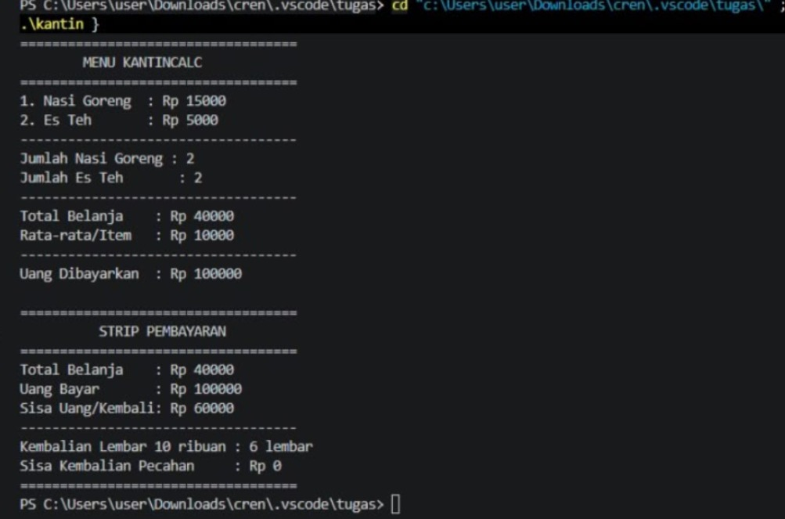

# KANTIN

Project Ujian Tengah Semester (UTS) mata pelajaran Pemrograman Dasar / Koding & Kecerdasan Artifisial kelas X PPLG. Aplikasi ini dibuat dalam dua versi bahasa pemrograman, yaitu *C* dan *Python*.

## Identitas Siswa
* *Nama Lengkap:* DEFINA FEBRIYANI 
* *Kelas:* X PPLG
* *No. Absen:* 13

## Deskripsi Aplikasi
KANTINCALC adalah program kasir kantin berbasis bahasa C yang berfungsi menghitung total belanja, rata-rata harga per item, dan kembalian secara otomatis, dengan fitur tampilan menu dan harga (Nasi Goreng dan Es Teh), input jumlah porsi, perhitungan total serta rata-rata per item, perhitungan kembalian beserta rincian pecahan Rp10.000, dan pencetakan struk pembayaran ringkas.

## Daftar File
* nama_file.c : Kode program utama menggunakan bahasa C.
* nama_file.py : Kode program utama menggunakan bahasa Python.
* output-program.png : Screenshot hasil menjalankan program aplikasi.

## Screenshot Output Program

